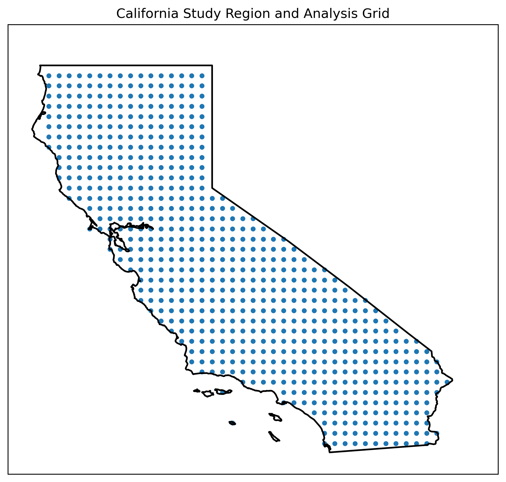
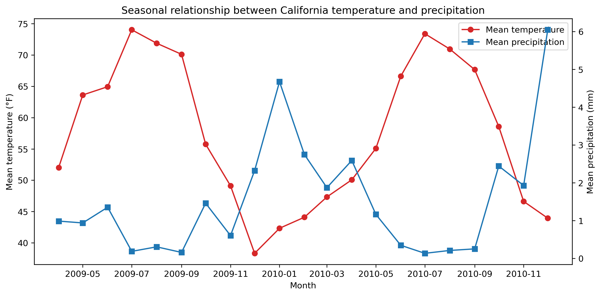
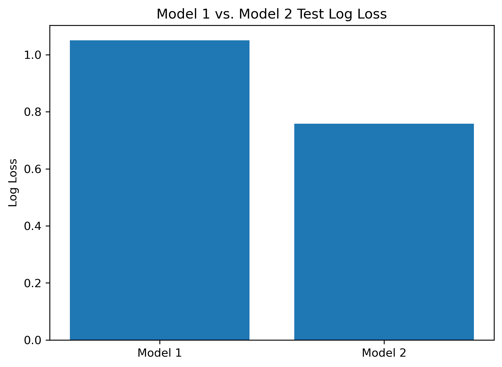
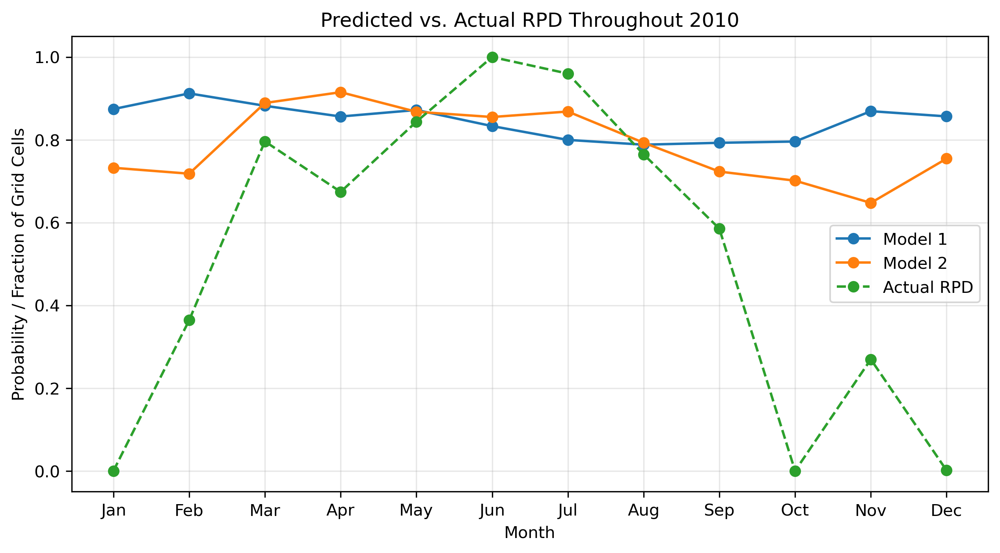
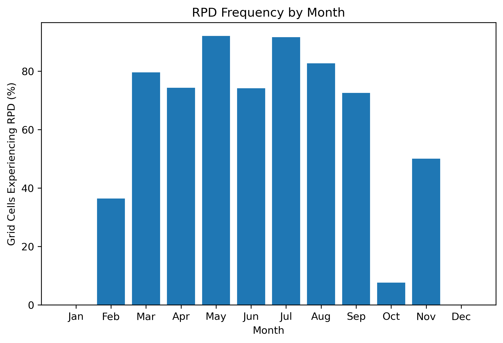

# Predicting Relative Precipitation Deficits in California

**Video:** https://youtu.be/D5gC_3JEDTw


## The Question

Can recent temperature and precipitation conditions be used to predict whether California will experience a relative precipitation deficit in the following month?

This project uses daily temperature and precipitation data from 2009–2010 to investigate precipitation deficits across a California study region. Monthly precipitation totals and temperature averages were calculated from the daily data. A relative precipitation deficit (RPD) was defined as a month in which precipitation was lower than the mean precipitation of the previous three months.

I used logistic regression to predict the probability of an RPD occurring. Two models were compared. **Model 1** used temperature and precipitation from the previous month. **Model 2** used previous-month temperature, precipitation from the previous three months, and the previous three-month mean precipitation. The models were trained using data from 2009 and evaluated on data from 2010.

## Results

Model performance was evaluated using **log loss**, which measures how well the predicted probabilities agree with the observed outcomes. Lower log loss indicates better probabilistic predictions.

| Model | Test Log Loss |
|---|---:|
| Model 1 | 1.050 |
| Model 2 | 0.758 |

Model 2 produced a substantially lower test log loss than Model 1, indicating that including a longer history of precipitation conditions improved the model's probabilistic predictions of relative precipitation deficits.

Model 2 reduced test log loss by approximately **28%** compared with Model 1. This suggests that recent precipitation history contains useful information for predicting whether precipitation will fall below the recent three-month average.

### Key Figures



*The California study region and analysis grid used in the project.*



*Monthly temperature and precipitation patterns across the study region.*



*Comparison of test log loss between the two logistic regression models. Lower values indicate better probabilistic predictions.*



*Predicted probability of relative precipitation deficit compared with the observed RPD frequency throughout 2010.*



*Frequency of relative precipitation deficits by month.*

## How to Run It

This project was developed using the `290A` conda environment.

From the project directory, run:

```bash
python run.py
```

The script performs the analysis from beginning to end and saves the resulting figures and model results to the `figures/` and `results/` directories.

The required climate data should be placed in the data directory described in this project. The data itself is not included in the GitHub repository.

## Contents

- `run.py` — Runs the complete analysis, including data processing, visualization, RPD calculation, logistic regression, and model evaluation.
- `figures/` — Contains figures generated by `run.py`.
- `results/` — Contains numerical results generated by the analysis.
- `Project1.ipynb` — Notebook used during development and exploration of the analysis.
- `.gitignore` — Prevents data files, checkpoints, and other unnecessary files from being committed to GitHub.
- `data:` — Local climate data used to run the analysis. This folder is excluded from GitHub.

## References

Climate data were obtained from the provided ERA5-style NetCDF datasets containing daily 2-m air temperature and total precipitation for 2009–2010.